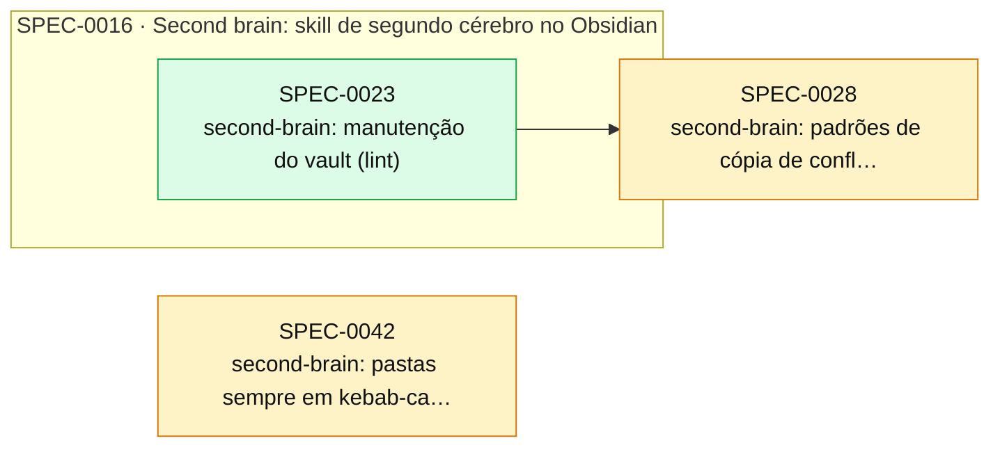

# Índice de Specs

> Gerado por `spec_graph.py index` em 2026-10-30 — não edite manualmente.

## Saúde

- Validação (G0): **4 erro(s), 21 aviso(s)** — rode `spec_graph.py validate`
- Specs: proposed 2, implemented 25
- Impedimentos: **0 aberto(s)**, 13 resolvido(s)

## Cobertura de Pilares

Perfil: **minimo**

| Pilar | Situação | Detalhe |
|---|---|---|
| Arquitetura e fronteiras | coberto | ADR-0001, ADR-0007, ADR-0008, ADR-0009 |
| Estratégia de testes | coberto | ADR-0002 |
| Qualidade de código | coberto | ADR-0003 |
| Entrega contínua e ambientes | dispensado | sem deploy nem ambientes: a skill é usada direto do checkout da main (link simbólico) ou copiada; release, versão e rollback estão no ADR-0005 |
| Fluxo de mudança | coberto | ADR-0005 |
| Segredos e dados sensíveis | dispensado | a skill e seus testes não usam credenciais nem dados pessoais; o board usa a autenticação da ferramenta do agente, nunca guardada aqui |

## Plano de Execução

**Em andamento:** —  
**Paradas por impedimento:** —  
**Próximo lote:** —

| Onda | Spec | Título | Tier/Tam. | Status | Prontidão | Observação |
|---|---|---|---|---|---|---|
| 1 | SPEC-0028 | second-brain: padrões de cópia de conflito reais por provedor | lite/S | proposed | ⏳ aguardando aprovação (H1) |  |
| 2 | SPEC-0042 | second-brain: pastas sempre em kebab-case | lite/S | proposed | ⏳ aguardando aprovação (H1) | saiu da onda 1: arquivos em comum com SPEC-0028 |

## Épicos

| Épico | Título | Status | Progresso |
|---|---|---|---|
| SPEC-0002 | Modo privado: SDD fora do repositório do time | implemented | 4/4 implementadas |
| SPEC-0016 | Second brain: skill de segundo cérebro no Obsidian | implemented | 11/11 implementadas |
| SPEC-0029 | org-atlas: mapa da organização para agentes | proposed | 0/0 implementadas |
| SPEC-0030 | org-atlas: probes — consultas ao vivo na infraestrutura | proposed | 0/0 implementadas |
| SPEC-0031 | Distribuição do ai-dev-brain: plugin, servidor MCP, marca e manutenção | proposed | 0/0 implementadas |

## Grafo de Dependências

Seta contínua: depende da implementação. Seta tracejada: consome contrato.

## Todas as Specs

| ID | Título | Tier | Tipo | Status | Criada | Épico | Depende de | Consome contrato |
|---|---|---|---|---|---|---|---|---|
| [SPEC-0001](SPEC-0001-ci-da-skill.md) | CI da skill: testes, lint e arquitetura | full | foundation | implemented | 2026-10-14 | — | — | — |
| [SPEC-0002](SPEC-0002-modo-privado.md) | Modo privado: SDD fora do repositório do time | epic | feature | implemented | 2026-10-14 | — | — | — |
| [SPEC-0003](SPEC-0003-registro-e-spec-root.md) | Registro do usuário e spec_root | full | feature | implemented | 2026-10-14 | SPEC-0002 | — | — |
| [SPEC-0004](SPEC-0004-leak-check.md) | Checagem de vazamento | full | feature | implemented | 2026-10-14 | SPEC-0002 | — | SPEC-0003@1 |
| [SPEC-0005](SPEC-0005-rastreio-sem-marcas.md) | Rastreio sem marcas no repositório | full | feature | implemented | 2026-10-14 | SPEC-0002 | — | SPEC-0003@1 |
| [SPEC-0006](SPEC-0006-pr-neutro-e-convencoes.md) | PR neutro, convenções do time e documentação do modo privado | full | feature | implemented | 2026-10-14 | SPEC-0002 | SPEC-0004, SPEC-0005 | SPEC-0003@1 |
| [SPEC-0007](SPEC-0007-pr-breaking-e-maiuscula.md) | PR do modo completo: breaking changes falso e texto em minúscula | lite | fix | implemented | 2026-10-14 | — | — | — |
| [SPEC-0008](SPEC-0008-spec-root-fora-do-repo.md) | Recusar spec_root dentro do repositório | lite | fix | implemented | 2026-10-14 | — | — | — |
| [SPEC-0009](SPEC-0009-gate-evidence-complemento.md) | gate --run grava o complemento de --evidence | lite | fix | implemented | 2026-10-14 | — | — | — |
| [SPEC-0010](SPEC-0010-isolamento-do-registro-nos-testes.md) | Testes antigos isolados do registro do usuário | lite | fix | implemented | 2026-10-14 | — | — | — |
| [SPEC-0011](SPEC-0011-documentos-vivos-guia-de-jornadas-e-mapa-do-sistema.md) | Documentos vivos: guia de jornadas e mapa do sistema | full | feature | implemented | 2026-10-26 | — | — | SPEC-0003@1 |
| [SPEC-0012](SPEC-0012-leak-check-acha-o-spec-root-tambem-pelo-caminho-nao-resolvid.md) | leak-check acha o spec_root também pelo caminho não resolvido | lite | fix | implemented | 2026-10-26 | — | SPEC-0011 | — |
| [SPEC-0013](SPEC-0013-novidades-da-skill-para-os-projetos-whats-new.md) | Novidades da skill para os projetos (whats-new) | full | feature | implemented | 2026-10-26 | — | — | SPEC-0003@1 |
| [SPEC-0014](SPEC-0014-validate-nao-sugere-a-politica-de-h2-ja-declarada.md) | validate não sugere a política de H2 já declarada | lite | fix | implemented | 2026-10-26 | — | — | — |
| [SPEC-0015](SPEC-0015-rodape-refs-decide-a-spec-do-commit.md) | Rodapé Refs decide a spec do commit | lite | fix | implemented | 2026-10-27 | — | — | — |
| [SPEC-0016](SPEC-0016-second-brain-skill-de-segundo-cerebro-no-obsidian.md) | Second brain: skill de segundo cérebro no Obsidian | epic | feature | implemented | 2026-10-30 | — | — | — |
| [SPEC-0017](SPEC-0017-second-brain-esqueleto-configuracao-em-duas-camadas-onboardi.md) | second-brain: esqueleto, configuração em duas camadas, onboarding e doctor | full | feature | implemented | 2026-10-30 | SPEC-0016 | — | — |
| [SPEC-0018](SPEC-0018-second-brain-busca-e-relacoes-entre-notas.md) | second-brain: busca e relações entre notas | full | feature | implemented | 2026-10-30 | SPEC-0016 | SPEC-0017 | — |
| [SPEC-0019](SPEC-0019-second-brain-fluxo-de-guardar.md) | second-brain: fluxo de guardar | full | feature | implemented | 2026-10-30 | SPEC-0016 | SPEC-0018 | — |
| [SPEC-0020](SPEC-0020-second-brain-fluxo-de-consultar.md) | second-brain: fluxo de consultar | full | feature | implemented | 2026-10-30 | SPEC-0016 | SPEC-0019 | — |
| [SPEC-0021](SPEC-0021-second-brain-inbox-e-captura-pelo-celular.md) | second-brain: inbox e captura pelo celular | full | feature | implemented | 2026-10-30 | SPEC-0016 | SPEC-0019 | — |
| [SPEC-0022](SPEC-0022-second-brain-processadores-de-video-e-documento.md) | second-brain: processadores de vídeo e documento | full | feature | implemented | 2026-10-30 | SPEC-0016 | SPEC-0021 | — |
| [SPEC-0023](SPEC-0023-second-brain-manutencao-do-vault-lint.md) | second-brain: manutenção do vault (lint) | full | feature | implemented | 2026-10-30 | SPEC-0016 | SPEC-0021 | — |
| [SPEC-0024](SPEC-0024-second-brain-exportacao-para-o-notebooklm.md) | second-brain: exportação para o NotebookLM | lite | feature | implemented | 2026-10-30 | SPEC-0016 | SPEC-0020 | — |
| [SPEC-0025](SPEC-0025-second-brain-vault-recem-criado-pelo-obsidian-recebe-a-estru.md) | second-brain: vault recém-criado pelo Obsidian recebe a estrutura padrão | lite | fix | implemented | 2026-10-30 | SPEC-0016 | SPEC-0017 | — |
| [SPEC-0026](SPEC-0026-second-brain-ajustes-da-busca-apontados-na-revisao-da-spec-0.md) | second-brain: ajustes da busca apontados nas revisões das SPEC-0018 e SPEC-0020 | lite | fix | implemented | 2026-10-30 | SPEC-0016 | SPEC-0020 | — |
| [SPEC-0027](SPEC-0027-second-brain-padroes-de-conflito-reais-e-ajustes-do-lint.md) | second-brain: ajustes do lint, da busca e da exportação | lite | fix | implemented | 2026-10-30 | SPEC-0016 | SPEC-0023, SPEC-0024, SPEC-0026 | — |
| [SPEC-0028](SPEC-0028-second-brain-padroes-de-copia-de-conflito-reais-por-provedor.md) | second-brain: padrões de cópia de conflito reais por provedor | lite | feature | proposed | 2026-10-30 | — | SPEC-0023 | — |
| [SPEC-0029](SPEC-0029-org-atlas-mapa-da-organizacao-para-agentes.md) | org-atlas: mapa da organização para agentes | epic | feature | proposed | 2026-10-30 | — | — | — |
| [SPEC-0030](SPEC-0030-org-atlas-probes-consultas-ao-vivo-na-infraestrutura.md) | org-atlas: probes — consultas ao vivo na infraestrutura | epic | feature | proposed | 2026-10-30 | — | SPEC-0029 | — |
| [SPEC-0031](SPEC-0031-distribuicao-plugin-mcp-marca-e-manutencao.md) | Distribuição do ai-dev-brain: plugin, servidor MCP, marca e manutenção | epic | feature | proposed | 2026-10-30 | — | — | — |
| [SPEC-0042](SPEC-0042-second-brain-pastas-sempre-em-kebab-case.md) | second-brain: pastas sempre em kebab-case | lite | feature | proposed | 2026-10-30 | — | SPEC-0016 | — |

## ADRs

| ID | Título | Status | Garantido por (G3) |
|---|---|---|---|
| [ADR-0001](../adr/ADR-0001-arquitetura-e-fronteiras.md) | Arquitetura e fronteiras | accepted | SPEC-0001 |
| [ADR-0002](../adr/ADR-0002-estrategia-de-testes.md) | Estratégia de testes | accepted | SPEC-0001 |
| [ADR-0003](../adr/ADR-0003-qualidade-de-codigo.md) | Qualidade de código | accepted | SPEC-0001 |
| [ADR-0005](../adr/ADR-0005-fluxo-de-mudanca.md) | Fluxo de mudança e versionamento da skill | accepted | N/A — repositório privado no plano gratuito do GitHub não tem proteção de branch; `validate` aponta commits diretos e merges fora de PR |
| [ADR-0006](../adr/ADR-0006-modo-privado.md) | Modo privado: estado do SDD fora do repositório | accepted | SPEC-0003 |
| [ADR-0007](../adr/ADR-0007-fronteiras-da-skill-second-brain.md) | Fronteiras da skill second-brain | accepted | SPEC-0017 |
| [ADR-0008](../adr/ADR-0008-armazenamento-do-vault-e-sincronizacao-entre-dispositivos.md) | Armazenamento do vault e sincronização entre dispositivos | accepted | SPEC-0017 |
| [ADR-0009](../adr/ADR-0009-processadores-externos-de-arquivos.md) | Processadores externos de arquivos | accepted | SPEC-0022 |
| [ADR-0010](../adr/ADR-0010-fronteiras-da-skill-org-atlas.md) | Fronteiras da skill org-atlas | proposed | SPEC-0029 |
