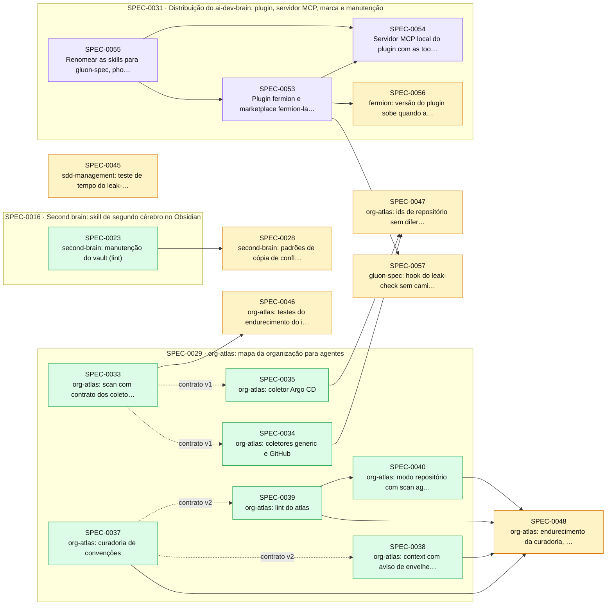

# Índice de Specs

> Gerado por `spec_graph.py index` em 2026-11-13 — não edite manualmente.

## Saúde

- Validação (G0): **6 erro(s), 21 aviso(s)** — rode `spec_graph.py validate`
- Specs: proposed 7, in-progress 3, implemented 41
- Impedimentos: **1 aberto(s)**, 22 resolvido(s)

## Impedimentos Abertos

| Spec | ID | Tipo | Fase/Gate | Responsável | Aberto em | Idade | Descrição |
|---|---|---|---|---|---|---|---|
| SPEC-0054 | IMP-01 | spec | G1 | thomas | 2026-11-13 | 0d | SPEC_DEFECT do Test-writer: o schema oficial 2026-07-28 diverge do contrato na era moderna — DiscoverResult exige resultType, ttlMs e cacheScope e põe a identidade em _meta['io.modelcontextprotocol/serverInfo'] (sem serverInfo no topo); todo resultado moderno exige resultType; ListToolsResult exige ttlMs e cacheScope; requests modernos trazem clientCapabilities em _meta |

## Cobertura de Pilares

Perfil: **minimo**

| Pilar | Situação | Detalhe |
|---|---|---|
| Arquitetura e fronteiras | coberto | ADR-0001, ADR-0007, ADR-0008, ADR-0009, ADR-0010, ADR-0011, ADR-0012, ADR-0013, ADR-0014, ADR-0015 |
| Estratégia de testes | coberto | ADR-0002 |
| Qualidade de código | coberto | ADR-0003 |
| Entrega contínua e ambientes | dispensado | sem deploy nem ambientes: a skill é usada direto do checkout da main (link simbólico) ou copiada; release, versão e rollback estão no ADR-0005 |
| Fluxo de mudança | coberto | ADR-0005 |
| Segredos e dados sensíveis | dispensado | a skill e seus testes não usam credenciais nem dados pessoais; o board usa a autenticação da ferramenta do agente, nunca guardada aqui |

## Plano de Execução

**Em andamento:** SPEC-0053, SPEC-0055  
**Paradas por impedimento:** SPEC-0054  
**Próximo lote:** —

| Onda | Spec | Título | Tier/Tam. | Status | Prontidão | Observação |
|---|---|---|---|---|---|---|
| 1 | SPEC-0055 | Renomear as skills para gluon-spec, photon-brain e boson-atlas | full/M | in-progress | 🔄 em andamento |  |
| 2 | SPEC-0053 | Plugin fermion e marketplace fermion-lab com as skills | full/S | in-progress | 🔄 em andamento |  |
| 2 | SPEC-0028 | second-brain: padrões de cópia de conflito reais por provedor | lite/S | proposed | ⏳ aguardando aprovação (H1) | saiu da onda 1: arquivos em comum com SPEC-0055 |
| 2 | SPEC-0045 | sdd-management: teste de tempo do leak-check tolerante à carga | lite/S | proposed | ⏳ aguardando aprovação (H1) | saiu da onda 1: arquivos em comum com SPEC-0055 |
| 3 | SPEC-0054 | Servidor MCP local do plugin com as tools atlas | full/M | in-progress | 🚧 parada por impedimento: IMP-01 (spec → thomas, 0d) |  |
| 3 | SPEC-0046 | org-atlas: testes do endurecimento do init e do doctor e regra de processo com alias | lite/S | proposed | ⏳ aguardando aprovação (H1) | saiu da onda 1: arquivos em comum com SPEC-0055; saiu da onda 2: max_parallel=3 |
| 3 | SPEC-0057 | gluon-spec: hook do leak-check sem caminho absoluto da instalação | lite/S | proposed | ⏳ aguardando aprovação (H1) |  |
| 4 | SPEC-0047 | org-atlas: ids de repositório sem diferença de caixa entre coletores | lite/S | proposed | ⏳ aguardando aprovação (H1) | saiu da onda 1: arquivos em comum com SPEC-0055; saiu da onda 2: max_parallel=3; saiu da onda 3: arquivos em comum com SPEC-0046 |
| 4 | SPEC-0056 | fermion: versão do plugin sobe quando as skills mudam | lite/S | proposed | ⏳ aguardando aprovação (H1) | saiu da onda 3: arquivos em comum com SPEC-0054 |
| 5 | SPEC-0048 | org-atlas: endurecimento da curadoria, do context e do lint, e alcance da rejeição | lite/S | proposed | ⏳ aguardando aprovação (H1) | saiu da onda 1: arquivos em comum com SPEC-0055; saiu da onda 2: max_parallel=3; saiu da onda 3: arquivos em comum com SPEC-0046; saiu da onda 4: arquivos em comum com SPEC-0047 |

## Épicos

| Épico | Título | Status | Progresso |
|---|---|---|---|
| SPEC-0002 | Modo privado: SDD fora do repositório do time | implemented | 4/4 implementadas |
| SPEC-0016 | Second brain: skill de segundo cérebro no Obsidian | implemented | 11/11 implementadas |
| SPEC-0029 | org-atlas: mapa da organização para agentes | implemented | 10/10 implementadas |
| SPEC-0030 | org-atlas: probes — consultas ao vivo na infraestrutura | proposed | 0/0 implementadas |
| SPEC-0031 | Distribuição do ai-dev-brain: plugin, servidor MCP, marca e manutenção | approved | 0/4 implementadas |

## Grafo de Dependências

Seta contínua: depende da implementação. Seta tracejada: consome contrato.

## Todas as Specs

| ID | Título | Tier | Tipo | Status | Criada | Épico | Depende de | Consome contrato |
|---|---|---|---|---|---|---|---|---|
| [SPEC-0001](SPEC-0001-ci-da-skill.md) | CI da skill: testes, lint e arquitetura | full | foundation | implemented | 2026-10-14 | — | — | — |
| [SPEC-0002](SPEC-0002-modo-privado.md) | Modo privado: SDD fora do repositório do time | epic | feature | implemented | 2026-10-14 | — | — | — |
| [SPEC-0003](SPEC-0003-registro-e-spec-root.md) | Registro do usuário e spec_root | full | feature | implemented | 2026-10-14 | SPEC-0002 | — | — |
| [SPEC-0004](SPEC-0004-leak-check.md) | Checagem de vazamento | full | feature | implemented | 2026-10-14 | SPEC-0002 | — | SPEC-0003@1 |
| [SPEC-0005](SPEC-0005-rastreio-sem-marcas.md) | Rastreio sem marcas no repositório | full | feature | implemented | 2026-10-14 | SPEC-0002 | — | SPEC-0003@1 |
| [SPEC-0006](SPEC-0006-pr-neutro-e-convencoes.md) | PR neutro, convenções do time e documentação do modo privado | full | feature | implemented | 2026-10-14 | SPEC-0002 | SPEC-0004, SPEC-0005 | SPEC-0003@1 |
| [SPEC-0007](SPEC-0007-pr-breaking-e-maiuscula.md) | PR do modo completo: breaking changes falso e texto em minúscula | lite | fix | implemented | 2026-10-14 | — | — | — |
| [SPEC-0008](SPEC-0008-spec-root-fora-do-repo.md) | Recusar spec_root dentro do repositório | lite | fix | implemented | 2026-10-14 | — | — | — |
| [SPEC-0009](SPEC-0009-gate-evidence-complemento.md) | gate --run grava o complemento de --evidence | lite | fix | implemented | 2026-10-14 | — | — | — |
| [SPEC-0010](SPEC-0010-isolamento-do-registro-nos-testes.md) | Testes antigos isolados do registro do usuário | lite | fix | implemented | 2026-10-14 | — | — | — |
| [SPEC-0011](SPEC-0011-documentos-vivos-guia-de-jornadas-e-mapa-do-sistema.md) | Documentos vivos: guia de jornadas e mapa do sistema | full | feature | implemented | 2026-10-26 | — | — | SPEC-0003@1 |
| [SPEC-0012](SPEC-0012-leak-check-acha-o-spec-root-tambem-pelo-caminho-nao-resolvid.md) | leak-check acha o spec_root também pelo caminho não resolvido | lite | fix | implemented | 2026-10-26 | — | SPEC-0011 | — |
| [SPEC-0013](SPEC-0013-novidades-da-skill-para-os-projetos-whats-new.md) | Novidades da skill para os projetos (whats-new) | full | feature | implemented | 2026-10-26 | — | — | SPEC-0003@1 |
| [SPEC-0014](SPEC-0014-validate-nao-sugere-a-politica-de-h2-ja-declarada.md) | validate não sugere a política de H2 já declarada | lite | fix | implemented | 2026-10-26 | — | — | — |
| [SPEC-0015](SPEC-0015-rodape-refs-decide-a-spec-do-commit.md) | Rodapé Refs decide a spec do commit | lite | fix | implemented | 2026-10-27 | — | — | — |
| [SPEC-0016](SPEC-0016-second-brain-skill-de-segundo-cerebro-no-obsidian.md) | Second brain: skill de segundo cérebro no Obsidian | epic | feature | implemented | 2026-10-30 | — | — | — |
| [SPEC-0017](SPEC-0017-second-brain-esqueleto-configuracao-em-duas-camadas-onboardi.md) | second-brain: esqueleto, configuração em duas camadas, onboarding e doctor | full | feature | implemented | 2026-10-30 | SPEC-0016 | — | — |
| [SPEC-0018](SPEC-0018-second-brain-busca-e-relacoes-entre-notas.md) | second-brain: busca e relações entre notas | full | feature | implemented | 2026-10-30 | SPEC-0016 | SPEC-0017 | — |
| [SPEC-0019](SPEC-0019-second-brain-fluxo-de-guardar.md) | second-brain: fluxo de guardar | full | feature | implemented | 2026-10-30 | SPEC-0016 | SPEC-0018 | — |
| [SPEC-0020](SPEC-0020-second-brain-fluxo-de-consultar.md) | second-brain: fluxo de consultar | full | feature | implemented | 2026-10-30 | SPEC-0016 | SPEC-0019 | — |
| [SPEC-0021](SPEC-0021-second-brain-inbox-e-captura-pelo-celular.md) | second-brain: inbox e captura pelo celular | full | feature | implemented | 2026-10-30 | SPEC-0016 | SPEC-0019 | — |
| [SPEC-0022](SPEC-0022-second-brain-processadores-de-video-e-documento.md) | second-brain: processadores de vídeo e documento | full | feature | implemented | 2026-10-30 | SPEC-0016 | SPEC-0021 | — |
| [SPEC-0023](SPEC-0023-second-brain-manutencao-do-vault-lint.md) | second-brain: manutenção do vault (lint) | full | feature | implemented | 2026-10-30 | SPEC-0016 | SPEC-0021 | — |
| [SPEC-0024](SPEC-0024-second-brain-exportacao-para-o-notebooklm.md) | second-brain: exportação para o NotebookLM | lite | feature | implemented | 2026-10-30 | SPEC-0016 | SPEC-0020 | — |
| [SPEC-0025](SPEC-0025-second-brain-vault-recem-criado-pelo-obsidian-recebe-a-estru.md) | second-brain: vault recém-criado pelo Obsidian recebe a estrutura padrão | lite | fix | implemented | 2026-10-30 | SPEC-0016 | SPEC-0017 | — |
| [SPEC-0026](SPEC-0026-second-brain-ajustes-da-busca-apontados-na-revisao-da-spec-0.md) | second-brain: ajustes da busca apontados nas revisões das SPEC-0018 e SPEC-0020 | lite | fix | implemented | 2026-10-30 | SPEC-0016 | SPEC-0020 | — |
| [SPEC-0027](SPEC-0027-second-brain-padroes-de-conflito-reais-e-ajustes-do-lint.md) | second-brain: ajustes do lint, da busca e da exportação | lite | fix | implemented | 2026-10-30 | SPEC-0016 | SPEC-0023, SPEC-0024, SPEC-0026 | — |
| [SPEC-0028](SPEC-0028-second-brain-padroes-de-copia-de-conflito-reais-por-provedor.md) | second-brain: padrões de cópia de conflito reais por provedor | lite | feature | proposed | 2026-10-30 | — | SPEC-0023 | — |
| [SPEC-0029](SPEC-0029-org-atlas-mapa-da-organizacao-para-agentes.md) | org-atlas: mapa da organização para agentes | epic | feature | implemented | 2026-10-30 | — | — | — |
| [SPEC-0030](SPEC-0030-org-atlas-probes-consultas-ao-vivo-na-infraestrutura.md) | org-atlas: probes — consultas ao vivo na infraestrutura | epic | feature | proposed | 2026-10-30 | — | SPEC-0029 | — |
| [SPEC-0031](SPEC-0031-distribuicao-plugin-mcp-marca-e-manutencao.md) | Distribuição do ai-dev-brain: plugin, servidor MCP, marca e manutenção | epic | feature | approved | 2026-10-30 | — | SPEC-0029 | — |
| [SPEC-0032](SPEC-0032-org-atlas-esqueleto-configuracao-init-e-doctor.md) | org-atlas: esqueleto, configuração em duas camadas, init e doctor | full | feature | implemented | 2026-10-30 | SPEC-0029 | — | — |
| [SPEC-0033](SPEC-0033-org-atlas-scan-contrato-snapshots-diff-redaction.md) | org-atlas: scan com contrato dos coletores, snapshots, diff e redaction | full | feature | implemented | 2026-10-30 | SPEC-0029 | SPEC-0032 | — |
| [SPEC-0034](SPEC-0034-org-atlas-coletores-generic-e-github.md) | org-atlas: coletores generic e GitHub | full | feature | implemented | 2026-10-30 | SPEC-0029 | SPEC-0032 | SPEC-0033@1 |
| [SPEC-0035](SPEC-0035-org-atlas-coletor-argo-cd.md) | org-atlas: coletor Argo CD | full | feature | implemented | 2026-10-30 | SPEC-0029 | SPEC-0032 | SPEC-0033@1 |
| [SPEC-0036](SPEC-0036-org-atlas-cruzamento-grafo-e-paginas.md) | org-atlas: cruzamento de fontes, grafo e páginas geradas | full | feature | implemented | 2026-10-30 | SPEC-0029 | SPEC-0033 | — |
| [SPEC-0037](SPEC-0037-org-atlas-curadoria-de-convencoes.md) | org-atlas: curadoria de convenções | full | feature | implemented | 2026-10-30 | SPEC-0029 | SPEC-0036 | — |
| [SPEC-0038](SPEC-0038-org-atlas-context-com-aviso-de-envelhecimento.md) | org-atlas: context com aviso de envelhecimento | full | feature | implemented | 2026-10-30 | SPEC-0029 | SPEC-0036 | SPEC-0037@2 |
| [SPEC-0039](SPEC-0039-org-atlas-lint.md) | org-atlas: lint do atlas | full | feature | implemented | 2026-10-30 | SPEC-0029 | SPEC-0036 | SPEC-0037@2 |
| [SPEC-0040](SPEC-0040-org-atlas-modo-repositorio-e-modo-local.md) | org-atlas: modo repositório com scan agendado e modo local | full | feature | implemented | 2026-10-30 | SPEC-0029 | SPEC-0039 | — |
| [SPEC-0041](SPEC-0041-sdd-management-org-context-no-discover.md) | sdd-management: org_context no DISCOVER | lite | feature | implemented | 2026-10-30 | SPEC-0029 | SPEC-0038 | — |
| [SPEC-0042](SPEC-0042-second-brain-pastas-sempre-em-kebab-case.md) | second-brain: pastas sempre em kebab-case | lite | feature | implemented | 2026-10-30 | — | SPEC-0016 | — |
| [SPEC-0043](SPEC-0043-second-brain-description-do-skill-md-dentro-do-limite-de-102.md) | second-brain: description do SKILL.md dentro do limite de 1024 caracteres | lite | fix | implemented | 2026-11-02 | — | — | — |
| [SPEC-0044](SPEC-0044-second-brain-captura-e-leitura-pelo-conector-do-provedor.md) | second-brain: captura e leitura pelo conector do provedor | full | feature | implemented | 2026-11-02 | — | SPEC-0021 | — |
| [SPEC-0045](SPEC-0045-sdd-management-teste-de-tempo-do-leak-check-tolerante-a-carg.md) | sdd-management: teste de tempo do leak-check tolerante à carga | lite | fix | proposed | 2026-11-02 | — | — | — |
| [SPEC-0046](SPEC-0046-org-atlas-testes-do-endurecimento-e-regra-de-processo.md) | org-atlas: testes do endurecimento do init e do doctor e regra de processo com alias | lite | fix | proposed | 2026-10-30 | — | SPEC-0033 | — |
| [SPEC-0047](SPEC-0047-org-atlas-ids-de-repositorio-sem-diferenca-de-caixa-entre-co.md) | org-atlas: ids de repositório sem diferença de caixa entre coletores | lite | fix | proposed | 2026-11-02 | — | SPEC-0034, SPEC-0035 | — |
| [SPEC-0048](SPEC-0048-org-atlas-endurecimento-da-curadoria-e-alcance-da-rejeicao.md) | org-atlas: endurecimento da curadoria, do context e do lint, e alcance da rejeição | lite | fix | proposed | 2026-11-02 | — | SPEC-0037, SPEC-0038, SPEC-0039, SPEC-0040 | — |
| [SPEC-0050](SPEC-0050-second-brain-itens-confidenciais-e-cofre-de-senhas.md) | second-brain: itens confidenciais e cofre de senhas | full | feature | implemented | 2026-11-02 | — | SPEC-0023, SPEC-0024, SPEC-0044 | — |
| [SPEC-0051](SPEC-0051-second-brain-versionamento-e-backup-do-vault.md) | second-brain: versionamento e backup do vault | full | feature | implemented | 2026-11-02 | — | SPEC-0017 | — |
| [SPEC-0052](SPEC-0052-second-brain-localizar-o-vault-pelo-conector-em-sessao-sem-c.md) | second-brain: localizar o vault pelo conector em sessão sem configuração | lite | fix | implemented | 2026-11-02 | — | SPEC-0044 | — |
| [SPEC-0053](SPEC-0053-plugin-fermion-e-marketplace-fermion-lab-com-as-skills.md) | Plugin fermion e marketplace fermion-lab com as skills | full | feature | in-progress | 2026-11-12 | SPEC-0031 | SPEC-0055 | — |
| [SPEC-0054](SPEC-0054-servidor-mcp-local-do-plugin-com-as-tools-atlas.md) | Servidor MCP local do plugin com as tools atlas | full | feature | in-progress | 2026-11-12 | SPEC-0031 | SPEC-0053, SPEC-0055 | — |
| [SPEC-0055](SPEC-0055-renomear-as-skills-para-gluon-spec-photon-brain-e-boson-atla.md) | Renomear as skills para gluon-spec, photon-brain e boson-atlas | full | migration | in-progress | 2026-11-12 | SPEC-0031 | SPEC-0029 | — |
| [SPEC-0056](SPEC-0056-fermion-versao-do-plugin-sobe-quando-as-skills-mudam.md) | fermion: versão do plugin sobe quando as skills mudam | lite | feature | proposed | 2026-11-13 | SPEC-0031 | SPEC-0053 | — |
| [SPEC-0057](SPEC-0057-gluon-spec-hook-do-leak-check-sem-caminho-absoluto-da-instal.md) | gluon-spec: hook do leak-check sem caminho absoluto da instalação | lite | fix | proposed | 2026-11-13 | — | SPEC-0053 | — |

## ADRs

| ID | Título | Status | Garantido por (G3) |
|---|---|---|---|
| [ADR-0001](../adr/ADR-0001-arquitetura-e-fronteiras.md) | Arquitetura e fronteiras | accepted | SPEC-0001 |
| [ADR-0002](../adr/ADR-0002-estrategia-de-testes.md) | Estratégia de testes | accepted | SPEC-0001 |
| [ADR-0003](../adr/ADR-0003-qualidade-de-codigo.md) | Qualidade de código | accepted | SPEC-0001 |
| [ADR-0005](../adr/ADR-0005-fluxo-de-mudanca.md) | Fluxo de mudança e versionamento da skill | accepted | N/A — repositório privado no plano gratuito do GitHub não tem proteção de branch; `validate` aponta commits diretos e merges fora de PR |
| [ADR-0006](../adr/ADR-0006-modo-privado.md) | Modo privado: estado do SDD fora do repositório | accepted | SPEC-0003 |
| [ADR-0007](../adr/ADR-0007-fronteiras-da-skill-second-brain.md) | Fronteiras da skill second-brain | accepted | SPEC-0017 |
| [ADR-0008](../adr/ADR-0008-armazenamento-do-vault-e-sincronizacao-entre-dispositivos.md) | Armazenamento do vault e sincronização entre dispositivos | accepted | SPEC-0017 |
| [ADR-0009](../adr/ADR-0009-processadores-externos-de-arquivos.md) | Processadores externos de arquivos | accepted | SPEC-0022 |
| [ADR-0010](../adr/ADR-0010-fronteiras-da-skill-org-atlas.md) | Fronteiras da skill org-atlas | accepted | SPEC-0029 |
| [ADR-0011](../adr/ADR-0011-modelo-neutro-do-atlas-e-contrato-dos-coletores.md) | Modelo neutro do atlas e contrato dos coletores | accepted | SPEC-0033 |
| [ADR-0012](../adr/ADR-0012-curadoria-de-convencoes-do-atlas.md) | Curadoria de convenções do atlas | accepted | SPEC-0037 |
| [ADR-0013](../adr/ADR-0013-conector-do-provedor-como-canal-de-captura-e-leitura.md) | Conector do provedor como canal de captura e leitura | accepted | SPEC-0044 |
| [ADR-0014](../adr/ADR-0014-itens-confidenciais-referencia-ao-cofre-e-opacidade.md) | Itens confidenciais: referência ao cofre e opacidade | accepted | SPEC-0050 |
| [ADR-0015](../adr/ADR-0015-rotacao-de-backups-como-unica-remocao-do-brain-py.md) | Rotação de backups como única remoção do brain.py | accepted | SPEC-0051 |
| [ADR-0016](../adr/ADR-0016-o-repositorio-e-o-plugin-fermion.md) | O repositório é o plugin fermion | accepted | tests/plugin/test_plugin.py (SPEC-0053:UT-01, UT-02, UT-05, IT-01) |
| [ADR-0017](../adr/ADR-0017-servidor-mcp-local-como-camada-fina-sobre-as-clis.md) | Servidor MCP local como camada fina sobre as CLIs | accepted | mcp/tests/test_architecture.py (SPEC-0054:UT-07) |
| [ADR-0018](../adr/ADR-0018-nomes-das-skills-gluon-spec-photon-brain-e-boson-atlas.md) | Nomes das skills: gluon-spec, photon-brain e boson-atlas | accepted | tests/plugin/test_skill_names.py (SPEC-0055:UT-01 a UT-04) |
