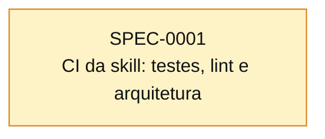

# Índice de Specs

> Gerado por `spec_graph.py index` em 2026-10-14 — não edite manualmente.

## Saúde

- Validação (G0): **0 erro(s), 0 aviso(s)**
- Specs: proposed 1
- Impedimentos: **0 aberto(s)**, 0 resolvido(s)

## Cobertura de Pilares

Perfil: **minimo**

| Pilar | Situação | Detalhe |
|---|---|---|
| Arquitetura e fronteiras | proposto | ADR-0001 (aguarda aprovação) |
| Estratégia de testes | proposto | ADR-0002 (aguarda aprovação) |
| Qualidade de código | proposto | ADR-0003 (aguarda aprovação) |
| Entrega contínua e ambientes | dispensado | sem deploy nem ambientes: a skill é usada direto do checkout da main (link simbólico) ou copiada; release, versão e rollback estão no ADR-0005 |
| Fluxo de mudança | proposto | ADR-0005 (aguarda aprovação) |
| Segredos e dados sensíveis | dispensado | a skill e seus testes não usam credenciais nem dados pessoais; o board usa a autenticação da ferramenta do agente, nunca guardada aqui |

## Plano de Execução

**Em andamento:** —  
**Paradas por impedimento:** —  
**Próximo lote:** —

| Onda | Spec | Título | Tier/Tam. | Status | Prontidão | Observação |
|---|---|---|---|---|---|---|
| 1 | SPEC-0001 | CI da skill: testes, lint e arquitetura | full/M | proposed | ⏳ aguardando aprovação (H1) |  |

## Grafo de Dependências

Seta contínua: depende da implementação. Seta tracejada: consome contrato.

## Todas as Specs

| ID | Título | Tier | Tipo | Status | Criada | Épico | Depende de | Consome contrato |
|---|---|---|---|---|---|---|---|---|
| [SPEC-0001](SPEC-0001-ci-da-skill.md) | CI da skill: testes, lint e arquitetura | full | foundation | proposed | 2026-10-14 | — | — | — |

## ADRs

| ID | Título | Status | Garantido por (G3) |
|---|---|---|---|
| [ADR-0001](../adr/ADR-0001-arquitetura-e-fronteiras.md) | Arquitetura e fronteiras | proposed | SPEC-0001 |
| [ADR-0002](../adr/ADR-0002-estrategia-de-testes.md) | Estratégia de testes | proposed | SPEC-0001 |
| [ADR-0003](../adr/ADR-0003-qualidade-de-codigo.md) | Qualidade de código | proposed | SPEC-0001 |
| [ADR-0005](../adr/ADR-0005-fluxo-de-mudanca.md) | Fluxo de mudança e versionamento da skill | proposed | N/A — repositório privado no plano gratuito do GitHub não tem proteção de branch; `validate` aponta commits diretos e merges fora de PR |
