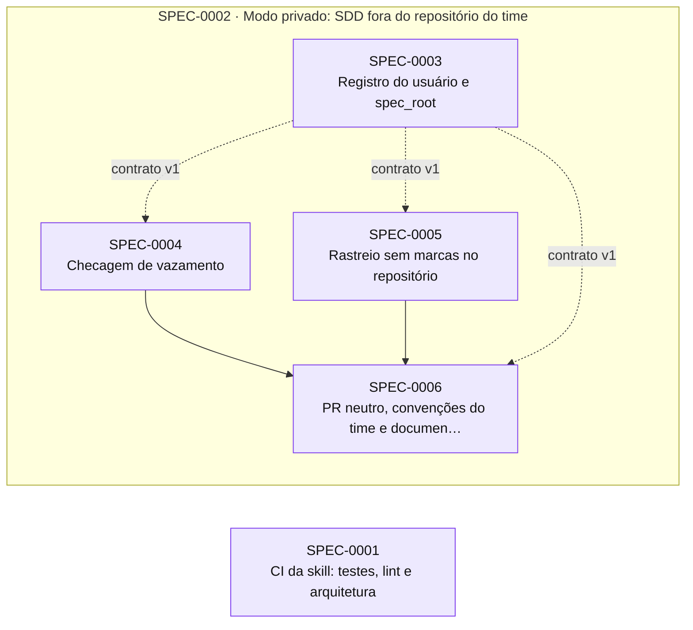

# Índice de Specs

> Gerado por `spec_graph.py index` em 2026-10-14 — não edite manualmente.

## Saúde

- Validação (G0): **0 erro(s), 1 aviso(s)** — rode `spec_graph.py validate`
- Specs: in-progress 5
- Impedimentos: **2 aberto(s)**, 3 resolvido(s)

## Impedimentos Abertos

| Spec | ID | Tipo | Fase/Gate | Responsável | Aberto em | Idade | Descrição |
|---|---|---|---|---|---|---|---|
| SPEC-0001 | IMP-02 | externo | G5 | thomas | 2026-10-14 | 0d | GitHub Actions não inicia jobs no repositório: 'recent account payments have failed or your spending limit needs to be increased' (runs 38650532309 e 38650548527); IT-01 e IT-02 sem evidência |
| SPEC-0002 | IMP-02 | externo | G5 | thomas | 2026-10-14 | 0d | G5 de todas as filhas depende da CI, e o GitHub Actions está bloqueado por cobrança (mesma causa do IMP-02 da SPEC-0001) |

## Cobertura de Pilares

Perfil: **minimo**

| Pilar | Situação | Detalhe |
|---|---|---|
| Arquitetura e fronteiras | coberto | ADR-0001 |
| Estratégia de testes | coberto | ADR-0002 |
| Qualidade de código | coberto | ADR-0003 |
| Entrega contínua e ambientes | dispensado | sem deploy nem ambientes: a skill é usada direto do checkout da main (link simbólico) ou copiada; release, versão e rollback estão no ADR-0005 |
| Fluxo de mudança | coberto | ADR-0005 |
| Segredos e dados sensíveis | dispensado | a skill e seus testes não usam credenciais nem dados pessoais; o board usa a autenticação da ferramenta do agente, nunca guardada aqui |

## Plano de Execução

**Em andamento:** SPEC-0003, SPEC-0004, SPEC-0005, SPEC-0006  
**Paradas por impedimento:** SPEC-0001  
**Próximo lote:** —

| Onda | Spec | Título | Tier/Tam. | Status | Prontidão | Observação |
|---|---|---|---|---|---|---|
| 1 | SPEC-0001 | CI da skill: testes, lint e arquitetura | full/M | in-progress | 🚧 parada por impedimento: IMP-02 (externo → thomas, 0d) |  |
| 2 | SPEC-0003 | Registro do usuário e spec_root | full/M | in-progress | 🔄 em andamento | saiu da onda 1: arquivos em comum com SPEC-0001 |
| 3 | SPEC-0004 | Checagem de vazamento | full/M | in-progress | 🔄 em andamento | saiu da onda 1: arquivos em comum com SPEC-0001; saiu da onda 2: arquivos em comum com SPEC-0003 |
| 4 | SPEC-0005 | Rastreio sem marcas no repositório | full/M | in-progress | 🔄 em andamento | saiu da onda 1: arquivos em comum com SPEC-0001; saiu da onda 2: arquivos em comum com SPEC-0003; saiu da onda 3: arquivos em comum com SPEC-0004 |
| 5 | SPEC-0006 | PR neutro, convenções do time e documentação do modo privado | full/M | in-progress | 🔄 em andamento |  |

## Épicos

| Épico | Título | Status | Progresso |
|---|---|---|---|
| SPEC-0002 | Modo privado: SDD fora do repositório do time | approved | 0/4 implementadas |

## Grafo de Dependências

Seta contínua: depende da implementação. Seta tracejada: consome contrato.

## Todas as Specs

| ID | Título | Tier | Tipo | Status | Criada | Épico | Depende de | Consome contrato |
|---|---|---|---|---|---|---|---|---|
| [SPEC-0001](SPEC-0001-ci-da-skill.md) | CI da skill: testes, lint e arquitetura | full | foundation | in-progress | 2026-10-14 | — | — | — |
| [SPEC-0002](SPEC-0002-modo-privado.md) | Modo privado: SDD fora do repositório do time | epic | feature | approved | 2026-10-14 | — | — | — |
| [SPEC-0003](SPEC-0003-registro-e-spec-root.md) | Registro do usuário e spec_root | full | feature | in-progress | 2026-10-14 | SPEC-0002 | — | — |
| [SPEC-0004](SPEC-0004-leak-check.md) | Checagem de vazamento | full | feature | in-progress | 2026-10-14 | SPEC-0002 | — | SPEC-0003@1 |
| [SPEC-0005](SPEC-0005-rastreio-sem-marcas.md) | Rastreio sem marcas no repositório | full | feature | in-progress | 2026-10-14 | SPEC-0002 | — | SPEC-0003@1 |
| [SPEC-0006](SPEC-0006-pr-neutro-e-convencoes.md) | PR neutro, convenções do time e documentação do modo privado | full | feature | in-progress | 2026-10-14 | SPEC-0002 | SPEC-0004, SPEC-0005 | SPEC-0003@1 |

## ADRs

| ID | Título | Status | Garantido por (G3) |
|---|---|---|---|
| [ADR-0001](../adr/ADR-0001-arquitetura-e-fronteiras.md) | Arquitetura e fronteiras | accepted | SPEC-0001 |
| [ADR-0002](../adr/ADR-0002-estrategia-de-testes.md) | Estratégia de testes | accepted | SPEC-0001 |
| [ADR-0003](../adr/ADR-0003-qualidade-de-codigo.md) | Qualidade de código | accepted | SPEC-0001 |
| [ADR-0005](../adr/ADR-0005-fluxo-de-mudanca.md) | Fluxo de mudança e versionamento da skill | accepted | N/A — repositório privado no plano gratuito do GitHub não tem proteção de branch; `validate` aponta commits diretos e merges fora de PR |
| [ADR-0006](../adr/ADR-0006-modo-privado.md) | Modo privado: estado do SDD fora do repositório | accepted | SPEC-0003 |
